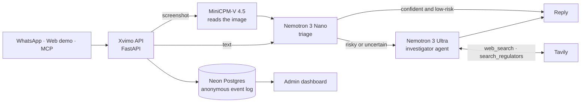
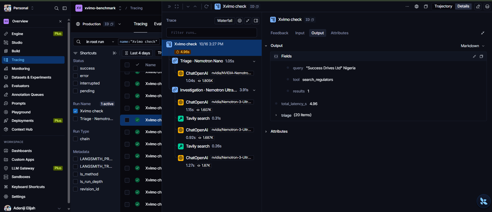
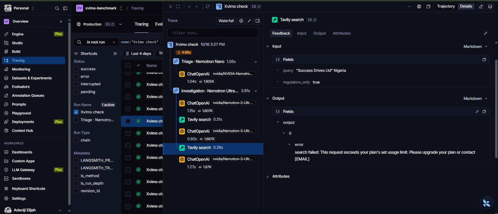
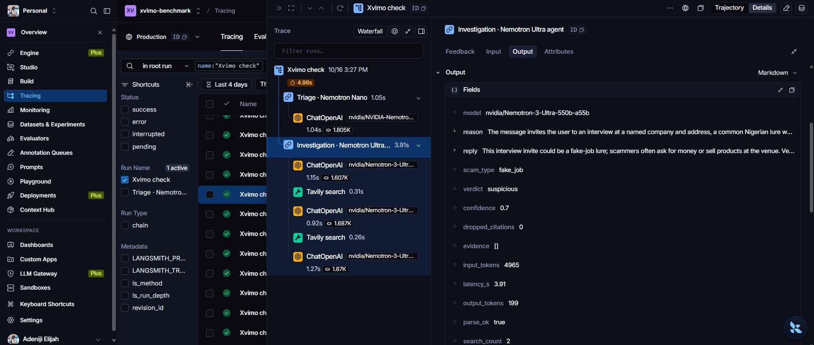
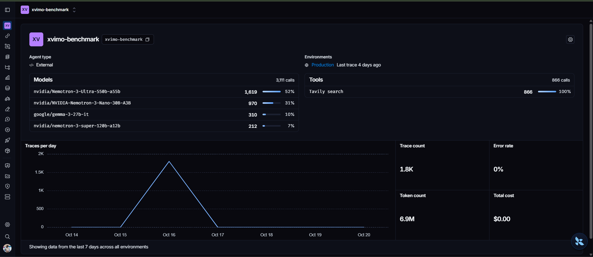
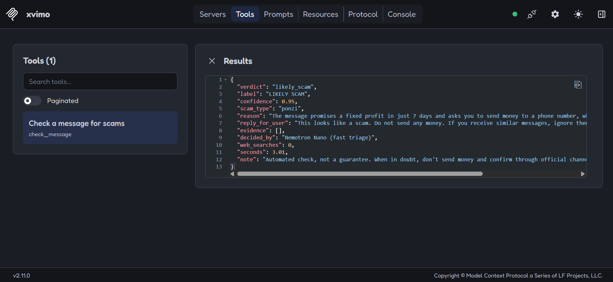

<p align="center">
  
</p>

<p align="center">
  <b>An open-source, agentic scam checker for Nigeria and Africa, built on NVIDIA Nemotron and running on Nebius Token Factory.</b><br>
  Forward a suspicious message or screenshot. Get a clear verdict, the reasons and the evidence before you send money.
</p>

<p align="center">
  <a href="https://xvimo.onrender.com"><b>▶ Try the live beta</b></a> ·
  <a href="#benchmark-how-well-does-xvimo-work">Benchmark</a> ·
  <a href="#use-xvimo-from-any-ai-agent-mcp">MCP server</a> ·
  <a href="#every-check-is-traced-langsmith">Traces</a> ·
  <a href="https://huggingface.co/datasets/Eterniti/NaijaScamBench">Dataset</a>
</p>

<p align="center">
  
  
  
  
</p>

---

## The problem

Ponzi schemes, fake job interviews, loan-app fraud, BVN and ATM "block" alerts, fake giveaways and romance scams cost ordinary people in Nigeria their savings every year. The people most at risk don't read regulator circulars or search company registries. They live on WhatsApp and SMS, and they have seconds to decide whether to pay.

**Xvimo meets them there.** A user pastes or forwards a message (or a screenshot of one) and gets:

- a clear verdict: **Likely scam**, **Suspicious** or **No red flags found**
- the reason, in plain language
- evidence from the web when it was checked: regulator warnings, news reports, company records
- a reply in the user's language: English, Nigerian Pidgin, Yoruba, Hausa or Igbo

## Try it

| Where | How |
|---|---|
| **Web demo** | [xvimo.onrender.com](https://xvimo.onrender.com): paste a message or upload a screenshot and watch each step of the agent live |
| **WhatsApp** | Linked from the web demo (sandbox beta) |
| **Any AI agent** | The [MCP server](#use-xvimo-from-any-ai-agent-mcp) lets Claude Desktop, Cursor or VS Code call Xvimo as a tool |

The demo runs on a free server that sleeps when idle, so the first check can take about 50 seconds to wake it up.

---

## How it works



**1. Triage: Nemotron 3 Nano (30B, 3B active).** Nano reads each message and returns structured JSON: verdict, confidence, scam type, language, organisations, links, promised returns and red flags. It answers about half of all messages alone, in about one second, for $0.14 per 1,000 messages.

**2. Routing: decided in code, not by the model.** A missed scam does far more harm than a false alarm, so routing is asymmetric:
- Nano **may raise an alarm on its own** when it is confident.
- Nano **may only clear a message on its own** when it is confident **and** the message avoids every high-risk topic: job interviews, BVN, ATM or account blocks, investments, loans, prizes, links, codes, fees and romance openers.
- Messages in Yoruba, Hausa or Igbo are never cleared by Nano alone.

*The small model can raise an alarm alone, but it can never clear a risky message without a second opinion.*

**3. Investigation: Nemotron 3 Ultra (550B, 55B active) agent.** Ultra receives the escalated message with two tools and decides for itself what to verify:
- `web_search`: the open web, including news, complaints, company sites and forums
- `search_regulators`: only official Nigerian sources (SEC, CBN, EFCC, FCCPC, NCC, NIMC, CAC, NDIC)

It writes its own queries, searches again if the evidence is thin (at most 3 rounds), and returns a verdict, a reason, cited evidence and a short reply in the user's language.

**Safeguards**
- **No invented sources.** Every cited URL is checked against the pages the agent actually retrieved. Anything else is removed and counted.
- **Tool-calling fallback.** If an endpoint doesn't support native tool calling, the agent switches to a JSON-action protocol automatically.
- **Fails safe.** If web search is unavailable, the agent still judges the message itself and says that nothing could be verified.
- **Spending protection.** Per-visitor rate limits and a daily check cap protect the model credits.

**Screenshots.** On the web demo, users can upload a screenshot. `openbmb/MiniCPM-V-4_5` (falling back to `google/gemma-3-27b-it`) reads it, and the text goes through the same pipeline.

---

## Benchmark: how well does Xvimo work?

We tested Xvimo on **330 labelled Nigerian messages** (169 scam, 161 legit) in English, Pidgin, Yoruba, Hausa and Igbo. We also ran the same triage prompt through several open models on Nebius Token Factory as a leaderboard.

| System | Accuracy | Scams caught | False alarms | Avg time | Cost / 1,000 msgs |
|---|---|---|---|---|---|
| Gemma 3 27B (single pass) | 96.4% | 99.4% | 6.8% | 4.7 s | – |
| Nemotron 3 Ultra (single pass) | 96.4% | 98.8% | 6.2% | 1.7 s | $2.27 |
| Nemotron 3 Nano (single pass) | 93.6% | 95.9% | 8.7% | 1.2 s | $0.14 |
| **Xvimo pipeline** (Nano triage → Ultra agent + web search) | 93.6% | 97.6% | 10.6% | 7.1 s | $3.90 |
| Nemotron 3 Super (single pass) | 78.8% | 99.4% | 42.9% | 2.4 s | – |

**What we learned:**
- On raw accuracy, the full agent pipeline does **not** beat a single Ultra call. What the agent adds is **evidence**: the sources it checked, regulator lookups and a plain-language safety tip. That costs time and money, and the agent was over-cautious on routine messages such as bank alerts and subscription reminders.
- We revised the agent's rules after this run. The revision raised scams caught to 99.4% (168 of 169), mainly by flagging fake job-interview invites, which in Nigeria often lead to a "training fee" at the venue. That run was cut short when our web-search credits ran out, so we don't report it as a final score. A final run on these 330 messages plus new, unseen messages will be reported here unchanged.
- Local languages are thin: 32 Pidgin messages, but only 4 each in Yoruba, Hausa and Igbo. Those 100% scores prove very little until we have more native-speaker data.
- Some constructed messages use placeholders like `[ACCOUNT]`, which can make real bank alerts look odd to models.

### The dataset: NaijaScamBench

| Source | Scam | Legit | Shared publicly |
|---|---|---|---|
| Constructed from documented Nigerian message patterns | 49 | 86 | ✅ |
| UCI SMS Spam Collection, everyday chat (CC BY 4.0) | – | 45 | ✅ |
| Real Nigerian scam SMS (Data Science Nigeria, via a public research repository) | 120 | – | ❌ no redistribution licence |
| Everyday Nigerian messages | – | 30 | ❌ |

The **180 shareable messages** are published on Hugging Face as **[NaijaScamBench](https://huggingface.co/datasets/Eterniti/NaijaScamBench)**, with a dataset card that lists its limitations. All personal details are replaced with placeholders (`[NAME]`, `[PHONE]`, `[ACCOUNT]`, `[AMOUNT]`, `[CODE]`).

Reproduce the leaderboard:
```bash
python bench.py              # all models + full pipeline (needs Nebius and Tavily keys)
python bench.py --limit 20   # quick smoke test
```
Runs can be stopped and resumed. Results go to `results/leaderboard.csv` and `results/leaderboard.md`.

---

### Every check is traced (LangSmith)
Each step is recorded: Nano triage, the routing decision, every Ultra agent turn and every web search. Phone numbers, emails and screenshot data are masked before upload. Tracing is used for benchmark runs only and is off on the public server. [Open the live trace](https://smith.langchain.com/public/648e826e-d57f-4f22-a0b6-a32b3e07b5c4/r/01a1451e-c3c6-77c2-a2b9-8cd36c6f0638?start_time=2026-10-16T14%3A30%3A06.534759Z) (kept for 14 days; screenshots below).

| Step tree | Web search the agent ran |
|---|---|
|  |  |
| **Agent verdict with evidence** | **Benchmark run: 3,111 model calls, 0% errors** |
|  |  |

---

### Use Xvimo from any AI agent (MCP)
Xvimo ships an MCP server, so Claude Desktop, Cursor, VS Code or any MCP client can check messages for scams.

    pip install "mcp>=2.0" httpx

Add to your MCP config:

    {"mcpServers": {"xvimo": {"command": "python", "args": ["path/to/xvimo/mcp_server.py"]}}}

No keys needed: it uses the hosted Xvimo beta (fair-use limits apply). Set `XVIMO_LOCAL=1` plus your own Nebius and Tavily keys to run the full Nemotron pipeline locally.



---

## Scam types covered

| Type | What it looks like |
|---|---|
| `ponzi` | Invest or deposit to receive guaranteed, high or fast returns |
| `advance_fee` | Pay a fee to *receive* promised money: grants, packages, visas, scholarships |
| `fake_loan` | Pay a fee to get a loan, or threats about an unpaid loan |
| `fake_job` | Unsolicited interview or "recruitment test" invites that lead to a fee or sales pitch |
| `impersonation` | Fake bank, CBN or EFCC messages; "new number" relatives; "I sent money by mistake" |
| `phishing_link` | Links asking for login, card, BVN, NIN or OTP details |
| `fake_giveaway` | "You won" a prize and must pay or share details to claim it |
| `romance` | A stranger who "found your number" and builds a relationship that turns into requests for money |

Xvimo also recognises **abusive, sexual or threatening** messages and gives block-and-report and safety advice.

---

## Privacy

- Messages are **not stored in full.** Each check keeps a 160-character preview with long numbers and emails masked, plus the verdict and timing.
- WhatsApp users are stored as the **last 4 digits** and an anonymous salted hash, never the full number. Web visitors are a random browser ID. There is no sign-in and no cookies.
- **Screenshots are not stored.**
- Messages are processed by Nebius Token Factory (models), Tavily (web search) and 360dialog/Meta (WhatsApp delivery).
- The admin dashboard is protected by a secret token. The database (Neon Postgres) is encrypted in transit.

Full details are on the [privacy page](https://xvimo.onrender.com/privacy).

---

## Tech stack

| Layer | Technology |
|---|---|
| Triage model | NVIDIA Nemotron 3 Nano (30B, A3B) |
| Investigator model | NVIDIA Nemotron 3 Ultra (550B, A55B), native tool calling |
| Screenshot reader | MiniCPM-V 4.5 (fallback: Gemma 3 27B) |
| Inference | **Nebius Token Factory** (OpenAI-compatible API) |
| Web evidence | Tavily Search (open web + Nigerian regulator domains) |
| Agent interface | MCP server (`check_message` tool) |
| Observability | LangSmith tracing with masking (benchmark runs) |
| Messaging | WhatsApp via 360dialog sandbox |
| Backend | Python, FastAPI, Uvicorn |
| Storage | Neon Postgres (falls back to local files) |
| Hosting | Docker image on GitHub Container Registry, deployed on Render; GitHub Actions keep-alive |
| Data | 330-message labelled benchmark (180 published as NaijaScamBench) |

---

## Run it yourself

```bash
git clone https://github.com/DataGuy-Eterniti/xvimo.git
cd xvimo
python -m venv .venv
.venv\Scripts\activate          # Windows
source .venv/bin/activate       # macOS / Linux
pip install -r requirements-deploy.txt
pip install pandas openpyxl langsmith "mcp>=2.0"   # optional: benchmark, tracing, MCP
```

Copy `deploy.env.example` to `.env` and fill in at least:

```env
LLM_BASE_URL=https://api.tokenfactory.nebius.com/v1/
LLM_API_KEY=your_nebius_token_factory_key
NANO_MODEL=nvidia/NVIDIA-Nemotron-3-Nano-30B-A3B
ULTRA_MODEL=nvidia/Nemotron-3-Ultra-550b-a55b
TAVILY_API_KEY=your_tavily_key
```

Then:

```bash
python xvimo.py "paste a suspicious message here"   # one check in the terminal
uvicorn dialog360_bot:app --port 8000               # web demo at http://localhost:8000/demo
```

`.env`, `data/` and `results/` are git-ignored. Never commit your keys.

## Project structure

```
xvimo/
├── triage.py            # Layer 1: Nemotron Nano triage + code-based routing
├── investigator.py      # Layer 2: Nemotron Ultra agent with Tavily tools
├── vision.py            # screenshot reader (MiniCPM-V, Gemma fallback)
├── xvimo.py             # end-to-end pipeline + command-line checker
├── dialog360_bot.py     # app entry point: WhatsApp webhook (360dialog) + web routes
├── demo.py / demo.html  # live web demo with step-by-step progress
├── dashboard.py / .html # admin dashboard
├── events.py            # anonymous event log (Postgres or local files)
├── limits.py            # daily check cap
├── safety.py            # harassment and threat safety advice
├── tracing.py           # optional LangSmith tracing with masking
├── bench.py             # benchmark + open-model leaderboard
├── mcp_server.py        # MCP server for AI agents
├── privacy.html         # privacy page
├── Dockerfile
└── docs/                # README screenshots
```

---

## Development history

| Date | Milestone |
|---|---|
| Early Oct | Nano triage with structured output and code-based safety-net routing |
| 3 Oct | Ultra investigator agent with Tavily tools; live on WhatsApp; admin dashboard |
| 8 Oct | Moved to Nebius Token Factory; public web demo with screenshot checks; open beta |
| 16 Oct | 330-message benchmark and open-model leaderboard; LangSmith tracing |
| 20 Oct | MCP server; NaijaScamBench dataset |

**Lessons we're keeping:**
- **Fixing false alarms in the prompt made the model too lenient on real scams.** Moving the final "is it safe?" decision for risky topics out of the model and into code fixed both.
- **The agent needs strict verdict rules.** Our first agent called routine bank alerts "suspicious". When we loosened the rules, it started clearing fake job invites. Each change is measured on the full benchmark before it goes live.
- **Measure before you claim.** Early numbers on 10–50 tuning messages looked perfect; the 330-message benchmark gave the honest picture above.

## Roadmap

- [x] Nano triage + asymmetric routing
- [x] Ultra investigator agent with web and regulator search, citation checking
- [x] WhatsApp bot, web demo, screenshot checks
- [x] Running on Nebius Token Factory
- [x] Admin dashboard with anonymous usage stats
- [x] 330-message benchmark + open-model leaderboard
- [x] LangSmith tracing, MCP server
- [x] NaijaScamBench published on Hugging Face (180 messages)
- [ ] Final benchmark on the revised agent, including new unseen messages
- [ ] Native-speaker review and more Yoruba, Hausa and Igbo messages
- [ ] Demo video and Devpost submission

## License

Released under the [MIT License](LICENSE).

## Acknowledgements

Built for the Nebius x NVIDIA Global AI Hackathon with NVIDIA Nemotron open models on Nebius Token Factory, and Tavily search. Nigerian scam SMS samples come from Data Science Nigeria research data; everyday SMS samples come from the UCI SMS Spam Collection (Almeida & Hidalgo, CC BY 4.0).
